<p align="center">
  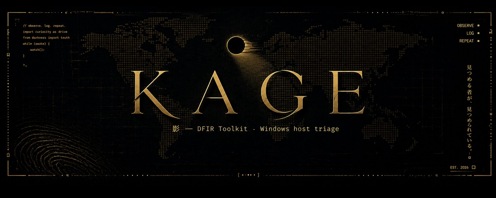
</p>

<p align="center">


<a href="https://ko-fi.com/k0r1m"></a>
<a href="https://youtu.be/PVJ-QQXbdfI"></a>
</p>
---

Point Kage at a suspect Windows host and it runs the whole triage in one chain:
**CyLR** collects the artefacts, **Hayabusa** correlates the event logs against
Sigma, **THOR Lite** scans for YARA matches, **VirusTotal** and **AbuseIPDB**
qualify the indicators, and the AI provider of your choice drafts the write-up.
Every stage streams live, seals what it produced, and can be replayed alone.

Not sitting at the suspect machine? Run the chain **remotely** on any Windows
host you administer, over WinRM. No live host at all? Give it a **disk image**
(E01, VMDK, VHD/VHDX, QCOW2, VDI or raw) and the same chain runs on the dead
disk, from Windows or Linux.

```powershell
kage.exe                        # one file, no Python → http://127.0.0.1:8787
kage.exe --remote PC07              # remote triage over WinRM
kage.exe --image D:\case\PC07.E01  # dead-disk triage
```

Or from source:

```bash
pip install -r requirements.txt
python -m dfirconsole
```

<p align="center">
  
  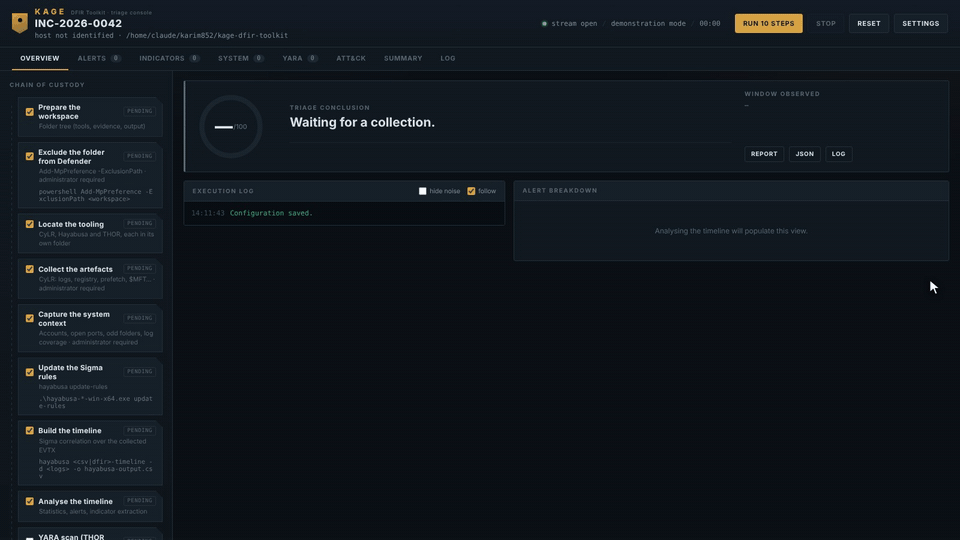
  <br><sub>The overview: eleven sealed steps on the left, the execution log
  streaming, and the score broken into its four components.</sub>
</p>

---

## 📑 Table of contents

- [Installation](#-installation)
- [Running your first scan](#-running-your-first-scan)
- [Remote triage](#-remote-triage)
- [Dead-disk triage](#-dead-disk-triage)
- [Adding THOR Lite manually](#-adding-thor-lite-manually)
- [The chain](#-the-chain)
- [Risk score](#-risk-score)
- [Alerts](#-alerts)
- [System context](#-system-context)
- [Logging & audit](#-logging--audit)
- [YARA](#-yara)
- [Seals](#-seals)
- [Views](#-views)
- [Configuration](#-configuration)
- [CLI reference](#-cli-reference)
- [Troubleshooting](#-troubleshooting)
- [Builds and releases](#-builds-and-releases)
- [Linux version](#-linux-version)
- [Credits](#-credits)

---

## 📦 Installation

### The single executable (recommended)

Download **`kage-windows-x64.exe`** from the
[Releases](../../releases) page, rename it `kage.exe` if you like, and put it in
an empty folder: `C:\Kage`, a USB stick, a case share.

```
C:\Kage\
└── kage.exe          ← that is all you need
```

Run it **as administrator**. The console window shows the address and the
browser opens on its own. Python is not needed; the web interface, its fonts
and the disk-image engine are all inside the file.

What appears next to it on first use:

```
C:\Kage\
├── kage.exe
├── config.json       your settings (written when you click Save)
├── apikeys.env       optional, your keys (you create it)
├── tools\
│   ├── cylr\         downloaded on first run
│   ├── hayabusa\     downloaded on first run
│   └── thor\         optional, you place it (see below)
├── evidence\
└── output\           reports, timeline, logs, manifests
```

**Is a THOR licence the only extra file?** Not quite. If you want the YARA
step, you place the **whole THOR Lite folder** in `tools\thor\` (scanner,
`.lic`, `signatures\`, `config\`), because THOR reads its rules from its own
folder. Nextron's licence forbids shipping it inside Kage. Without it, that one
step is skipped and everything else works.

**Why are CyLR and Hayabusa not inside the exe?** Their licences (GPL-3.0 and
AGPL-3.0) come with obligations a single closed bundle would break, and they
release often. Kage downloads the current Windows build into `tools\` on first
run. On a machine **without internet**, run it once on a connected machine and
copy the `tools\` folder across with `kage.exe`.

> The exe is not code-signed. SmartScreen may show *Windows protected your PC*:
> click **More info → Run anyway**, or check the file against
> `SHA256SUMS.txt` published with each release first.

### From source

#### Requirements

| | |
|---|---|
| OS | Windows 10 / 11 or Windows Server |
| Python | 3.10+ from [python.org](https://www.python.org/downloads/), **installed for all users** |
| Rights | **Administrator**  |
| Disk | a few GB free for the collection |


#### Install

```powershell
# 1. Extract Kage anywhere — Desktop, C:\Kage, a USB stick, it does not matter
cd C:\Kage

# 2. Install the dependencies
pip install -r requirements.txt

# 3. Check the environment before touching a host
python preflight.py
```

`preflight.py` reports what is ready and what is missing.

```
Workspace   : C:\Kage
System      : Windows 11
Python      : 3.12.3

Dependencies
  [ok]   module fastapi
  [ok]   module uvicorn
  [ok]   module httpx

Rights and disk space
  [ok]   console running as administrator
  [ok]   free space: 84.2 GB

Tooling
  [!]    CyLR in C:\Kage\tools\cylr
           → the "Locate the tooling" step downloads it
  [!]    THOR Lite
           → optional step — it will simply be skipped
```

#### Launch — as Administrator

```powershell
python -m dfirconsole
```

Or right-click **`launch.bat`** → *Run as administrator*, which handles the
virtualenv, the install and opens the browser for you.

```
Kage DFIR Toolkit 1.6.0
  code      C:\Kage\dfirconsole
  workspace C:\Kage
  open      http://127.0.0.1:8787
```

> **The workspace is wherever you launched from.** Nothing to configure. Tools,
> evidence and output all land next to the console.

### Try it with no risk first

```powershell
python -m dfirconsole --demo
```

Demonstration mode builds a synthetic intrusion — malicious attachment, encoded
PowerShell, Defender disabled, credential theft, persistence, C2, shadow copies
deleted — and runs the entire chain on it. Nothing on your machine is touched.
The best way to learn the interface before a real incident.

---

## 🚀 Running your first scan

### Step 1 — Open the console

Launch as administrator, open <http://127.0.0.1:8787>, and check the status bar
reads **`live run · Windows`** and not `demonstration mode`.

### Step 2 — Name the case

Click **Settings**:

| Field | Example | Why it matters |
|---|---|---|
| Case reference | `INC-2026-0042` | names the report, the log and the archive |
| Analyst | `N. Delaunay` | appears on the report header |

Leave **Workspace folder** empty it tracks the launch folder on its own.
Click **Save**.

### Step 3 — Warm up before committing

The left column is the **chain of custody**. Every step has a checkbox; all are
ticked by default except the YARA scan.

**For a first run, untick everything except:**

```
☑ Prepare the workspace
☑ Exclude the folder from Defender
☑ Locate the tooling
☑ Update the Sigma rules
```

Click **Run 4 steps**. About a minute. This downloads CyLR and Hayabusa and
confirms your elevation actually works *before* anything long begins.

### Step 4 — Collect and analyse

Once those four are sealed, tick the rest:

```
☑ Collect the artefacts        CyLR — a few minutes, several GB
☑ Capture the system context   accounts, sockets, disk root, log coverage
☑ Build the timeline           Hayabusa correlates against Sigma
☑ Analyse the timeline         score, alert families, indicators
```

Click **Run** and watch the execution log stream. Each finished step gets a
**seal** — a SHA-256 you can verify later.

### Step 5 — Read the results

| Where | What you get |
|---|---|
| **Overview** | risk score with its four components, alerts by family |
| **Alerts** | every alert, filterable by severity and family |
| **System** | accounts, sockets tied to processes, odd folders, log coverage |
| **Indicators** | hashes, IPs and domains extracted from the timeline |

**Click any table row** to open the reading pane: every field, the full command
line, all raw data. `←` `→` to move between items, `Esc` to close.

### Step 6 — Enrich and conclude *(optional)*

With API keys configured:

```
☑ Enrich the indicators    VirusTotal + AbuseIPDB reputation
☑ Write the summary        the AI drafts the report
```

Without keys, enrichment is marked *skipped* and the summary step writes a
**local write-up** instead. Same structure, no network call.

### Step 7 — Export

Top right of the dashboard:

- **Report** — printable HTML, thirteen numbered sections, ready for PDF
- **JSON** — the complete state, seals included
- **Log** — everything the console produced

> 💡 **Replay a single step:** double-click its tag in the left column. Useful
> when Hayabusa fails but the collection is fine — no need to collect twice.

---

## 🛰️ Remote triage

You administer the suspect machine but you are not in front of it. Kage stays
on **your** workstation and runs the usual chain on the remote host through
**WinRM** (PowerShell Remoting), the channel Windows admins already use.

```powershell
kage.exe --remote PC-FINANCE-07                         # your Windows session (domain)
kage.exe --remote 10.20.4.11 --remote-user .\Administrator   # a local account, password asked once
```

or **Settings → Evidence source → Remote host**, fill in the host, click
**Test connection**, **Save**.

### What happens on the remote host

| Step | On the remote host | On your workstation |
|---|---|---|
| Connect | checks the session has the administrator token | |
| Collect | `CyLR.exe` is pushed to `C:\Windows\Temp\Kage-<case>`, run with your CyLR arguments | |
| Fetch | | the archive is downloaded in 4 MB chunks, its **SHA-256** checked against the one the host computed |
| Clean up | the temporary folder is deleted, **even if a step failed** | |
| System context | the **same commands** as a live capture: `systeminfo`, `Get-LocalUser`, `netstat -ano`, `tasklist`, `auditpol`, `Get-WinEvent -ListLog`, the C:\ listing | the **same parsers** |
| Timeline, analysis, YARA, report | | exactly as for a local collection |

Everything is recorded in `output\<case>-remote-manifest.json`: host, account,
transport, CyLR hash, archive hash, start and end times, clean-up status. The
manifest is part of the collection seal and the report names the host and the
archive hash.

### Same results as a local run

Same CyLR, same archive, same Hayabusa, same parsers. The test suite proves it
on a simulated host: the remote capture and the live capture of that host give
**identical** system context and identical event logs, byte for byte.
`tests/e2e_sources.py` goes further with the real Hayabusa and real attack
logs: collector, live, log folder, remote and seven image formats all give
the same timeline (43 events, 5 critical, 15 high on the sample set).

### What the remote host needs

| | |
|---|---|
| WinRM enabled | on by default on Windows Server 2012 and later; **off on Windows 10 / 11**: run `Enable-PSRemoting -Force` on the target, or enable it fleet-wide by GPO |
| Firewall | TCP **5985** (HTTP, still encrypted by Kerberos/NTLM) or **5986** (HTTPS) from your workstation |
| Account | member of the host's **Administrators** group |
| Local account | UAC strips its admin token remotely unless `LocalAccountTokenFilterPolicy` is 1; a domain account avoids this |

**Credentials.** Leave the account empty on a domain workstation: your Windows
session authenticates (Kerberos), nothing is typed or stored. A password you
type is kept **in memory for the session only**, never written to
`config.json`. To provide it unattended, set `KAGE_REMOTE_PASSWORD` in the
environment or in `apikeys.env`.

**From Linux too.** The WinRM client is pure Python, so the Linux build can
triage a Windows host remotely. It pushes the Windows CyLR and runs the Linux
Hayabusa locally.

> **Large collections.** WinRM is not a file-transfer protocol: expect a few
> MB/s. The default CyLR set (logs, registry, `$MFT`) is usually a few hundred
> MB. Trim it with CyLR arguments if the link is slow.

---

## 💽 Dead-disk triage

When the host is already powered off, seized, or only reachable as a disk image,
point Kage at the image. It opens it **read-only**, finds the Windows volume and
pulls out what the chain needs. No mounting, no admin rights, no Windows
required: the Linux build does it too.

| Format | Extensions |
|---|---|
| EnCase / EWF | `.E01`, `.Ex01`, `.S01` (point to the first segment; the others are found in the same folder) |
| VMware | `.vmdk` (plain and split) |
| Hyper‑V / Azure | `.vhd`, `.vhdx` |
| QEMU / KVM | `.qcow2` |
| VirtualBox | `.vdi` |
| Raw | `.dd`, `.raw`, `.img`, `.bin`, `.001` |

### Start on an image

```powershell
kage.exe --image D:\case\PC07.E01
```

or **Settings → Evidence source → Disk image**, paste the path (with or without
quotes, the way Explorer copies it), **Save**. The status bar now reads
`disk image · PC07.E01`.

Then tick only what makes sense for a dead disk and run:

```
☑ Prepare the workspace
☑ Collect the artefacts        read from the image, CyLR not used
☑ Capture the system context   from the registry hives, not live commands
☑ Update the Sigma rules
☑ Build the timeline
☑ Analyse the timeline
```

### What is read from the image

| Artefact | Source in the image | Used by |
|---|---|---|
| Event logs | `Windows\System32\winevt\Logs\*.evtx` | Hayabusa timeline, log coverage |
| Host identity | `SYSTEM` and `SOFTWARE` hives | name, OS build, domain, time zone, install date |
| Local accounts | `SAM` hive | enabled or not, last logon, admin membership, nested domain groups |
| Persistence | Run keys and services | **Autoruns** card, user-writable paths flagged |
| Disk root | `C:\` listing | odd folders, with their age compared to the last log write |
| Prefetch | `Windows\Prefetch` | kept in the extraction |
| Executables | `Downloads`, `Desktop`, `Documents`, `AppData`, `Users\Public`, `ProgramData`, `Windows\Temp`, `PerfLogs` | YARA scope (50 MB per file, 1 GB total, set in Settings) |

Everything extracted is listed in `output\<case>-image-manifest.json`, one line
per file with its path in the image, its size and its **SHA-256**. The manifest
also records the image itself: format, segments, size and a SHA-256 of its first
64 MB (enough to tell two images apart without hashing 500 GB). The full
acquisition hash stays the job of `ewfverify` or your imaging tool. The
manifest is part of the collection seal.

### What a disk image cannot give you

| Missing | Why |
|---|---|
| Network sockets | they only exist on a running system |
| Audit policy | read with `auditpol` on a live host |
| Running processes | same reason as sockets |

The **System** view and the report say so plainly instead of showing empty
tables. Encrypted volumes (BitLocker) must be decrypted before Kage can read
them.

### YARA on an image

Leave **Settings → YARA scan folder** empty and THOR scans the extraction: the
executables pulled from the image, not your own machine.

---

## 🔦 Adding THOR Lite manually

The YARA scan is the one step Kage **cannot** set up for you. Nextron requires
registration, so the binary cannot be fetched by a script. CyLR and Hayabusa
download themselves; THOR does not.

### 1. Get the archive

Register and download at
[nextron-systems.com/thor-lite](https://www.nextron-systems.com/thor-lite/).
You receive the scanner **and a licence file** (`.lic`) — usually by email.

### 2. Drop it in `tools\thor\`

Kage creates that folder at first launch, next to `kage.exe` or next to the
sources. Copy the archive's contents into it, **keeping everything together**:

```
C:\Kage\
└── tools\
    └── thor\                    ← everything goes here
        ├── thor64-lite.exe        the scanner
        ├── yourname.lic           the licence — THOR will not start without it
        ├── config\                from the archive
        ├── signatures\            from the archive — the YARA rules themselves
        └── custom-signatures\     from the archive
```

> **Why keep them together?** THOR runs from the directory holding its
> executable and resolves its signatures relative to that directory. Copying
> the binary alone gives you a scanner with nothing to scan for.

The other two tools live beside it, each in its own folder:

```
tools\
├── cylr\        CyLR.exe                 ← downloaded automatically
├── hayabusa\    hayabusa-<version>.exe   ← downloaded automatically
└── thor\        thor64-lite.exe + .lic   ← you place this one
```

### 3. Verify

```powershell
kage.exe --check          # or: python preflight.py
```

```
Tooling
  [ok]   CyLR in C:\Kage\tools\cylr
  [ok]   Hayabusa in C:\Kage\tools\hayabusa
  [ok]   THOR Lite: C:\Kage\tools\thor\thor64-lite.exe
  [ok]   THOR licence file (*.lic)
```

If the licence line shows `[!]`, THOR will start and stop immediately.

### 4. Choose the scope — this decides everything

**Settings → YARA scan folder:**

| Value | Scans | Takes |
|---|---|---|
| *(empty)* | the artefacts CyLR just collected, or the files extracted from a disk image | minutes |
| `C:\Users\target` | one user profile | minutes |
| `C:\` | the whole system volume | **hours** |

Tick **YARA scan** in the chain and run it. Verdicts appear live as files are
examined — alerts, warnings, notices *and* clean files, each with its hash.

**No time limit by default.** A three-hour sweep is a decision, not an anomaly.
Set one in minutes if you want a ceiling.

> Without THOR, the step reports itself as *skipped* and the chain carries on.
> You lose the YARA axis of the score — nothing else.

---

## 🔗 The chain

Eleven steps. Tick what you need, double-click a tag to replay one alone.

| # | Step | What actually runs |
|---|---|---|
| 01 | Prepare the workspace | folder tree, elevation and free-space check |
| 02 | Exclude from Defender | `Add-MpPreference -ExclusionPath <workspace>` |
| 03 | Locate the tooling | resolves and downloads CyLR + Hayabusa from GitHub releases |
| 04 | Collect the artefacts | `CyLR.exe -od evidence\ -of <case>.zip -v` |
| 05 | Capture the system context | `systeminfo` · `Get-LocalUser` · `netstat -ano` · `tasklist` · `auditpol` |
| 06 | Update the Sigma rules | `hayabusa update-rules` |
| 07 | Build the timeline | `hayabusa <csv\|dfir>-timeline -d <Logs> -o hayabusa-output.csv -r <rules>` |
| 08 | Analyse the timeline | score, alert families, indicator extraction |
| 09 | YARA scan *(optional)* | `thor64-lite.exe --nocsv -p <chosen folder>` |
| 10 | Enrich the indicators | VirusTotal v3 · AbuseIPDB v2 |
| 11 | Write the summary | your AI provider, or a local write-up |

The Hayabusa subcommand is read from its own help output, so v3
(`csv-timeline`) and v4 (`dfir-timeline`) both work, and unsupported flags are
dropped rather than failing the command.

---

## 🎯 Risk score

A **triage priority, not a proof** — and never published without its breakdown.

```
71 / 100        Compromise highly likely — corroboration still limited
                CONFIDENCE MEDIUM · 43 events analysed

SEVERITY        43 / 45   5 critical, 15 high, 9 medium · 17 distinct rules
KILL CHAIN      24 / 25   8 ATT&CK tactics, 6 decisive
REPUTATION       0 / 20   no indicator confirmed externally
CORROBORATION    4 / 10   1 suspicious connection to a public host
```

Four independent axes, **each capped**:

| Axis | Max | What it counts |
|---|---|---|
| Severity | 45 | **distinct** detection rules (critical 8, high 3, medium 1), plus a small volume bonus that stops past about 20 alerts |
| Kill chain | 25 | ATT&CK tactics of the **alerts**, from each rule's own tags (Hayabusa's verbose profile); decisive tactics count twice |
| Reputation | 20 | indicators confirmed malicious (10) or suspicious (3) by VirusTotal / AbuseIPDB |
| Corroboration | 10 | YARA detections (6), live connections **already flagged** as suspicious (4) |

Both curves rise fast at first and flatten near the top, so one noisy rule
firing three hundred times weighs like one rule, and only a broad intrusion
gets near the cap.

**Calibrated on real attacks.** `tests/score_eval.py` scores about 1 000 cases
built from the 600 public Hayabusa sample recordings (one technique, two,
three, five, eight, and noisy repeats). Median scores, before and after this
calibration:

| | one technique | 3 techniques | 5 techniques | 8 techniques | same technique ×20 |
|---|---|---|---|---|---|
| Before | 47 | 70 | 70 | 70 | +9 |
| Now | 27 | 49 | 61 | 65 | +4 |

The old curves gave the full 45 for one critical plus one high alert and the
full 25 for five tactics, so anything bigger than one technique sat on 70.
Timeline evidence alone now stays under 70: **the top band takes corroboration**
(a YARA hit, a flagged socket, a confirmed indicator).

**Confidence is separate from severity.** It counts how many independent sources
agree and whether logging coverage was sufficient — so a high score built on
Sigma alone reads as a strong lead, never a confirmation:

| Score | Confidence high | Confidence low |
|---|---|---|
| ≥ 70 | Compromise confirmed by multiple sources | Compromise highly likely — corroboration still limited |
| ≥ 45 | Likely compromise — containment recommended | Strong indications from a single source |
| ≥ 25 | Suspicious activity requiring qualification | |
| ≥ 10 | Weak signals, no established compromise | |
| < 10 | Nothing conclusive | |

Recomputed each time a new source lands — after the timeline, after YARA, after
enrichment.

---

## 🚨 Alerts

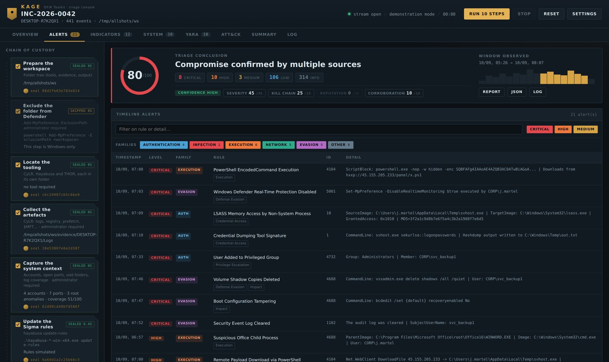

Severity says how urgent. Families say what kind.

```
FAMILIES   AUTHENTICATION 4   INFECTION 1   EXECUTION 6
           NETWORK 5          EVASION 5     OTHER 0

TIMESTAMP        LEVEL     FAMILY   RULE                              ID
09/09 10:26      CRITICAL  EVASION  Windows Defender Disabled         5001
09/09 11:09      CRITICAL  EVASION  Volume Shadow Copies Deleted      4688
09/09 11:15      CRITICAL  EVASION  Security Event Log Cleared        1102
09/09 10:32      CRITICAL  AUTH     LSASS Memory Access               10
```

Classified by event ID first, wording second. **When the two disagree, the text
wins**: a `4688` is a process creation, but `vssadmin delete shadows` belongs
under Evasion, because that is where an analyst will look for it.

**The family counts always match the table.** Computed over the alerts that
actually reach the list — a badge promising rows you cannot find is a bug, not a
detail.

**The histogram follows the selection.** With one family active, the observed
window is redrawn in that family's colour and a tick marks its busiest moment.

**The triage does not flag itself.** THOR writes to the Windows event log while
it runs, and scanning a folder of offensive binaries makes Hayabusa flag our own
scanner. Those events are excluded, counted apart, and the total reported.

---

## 🖥️ System context

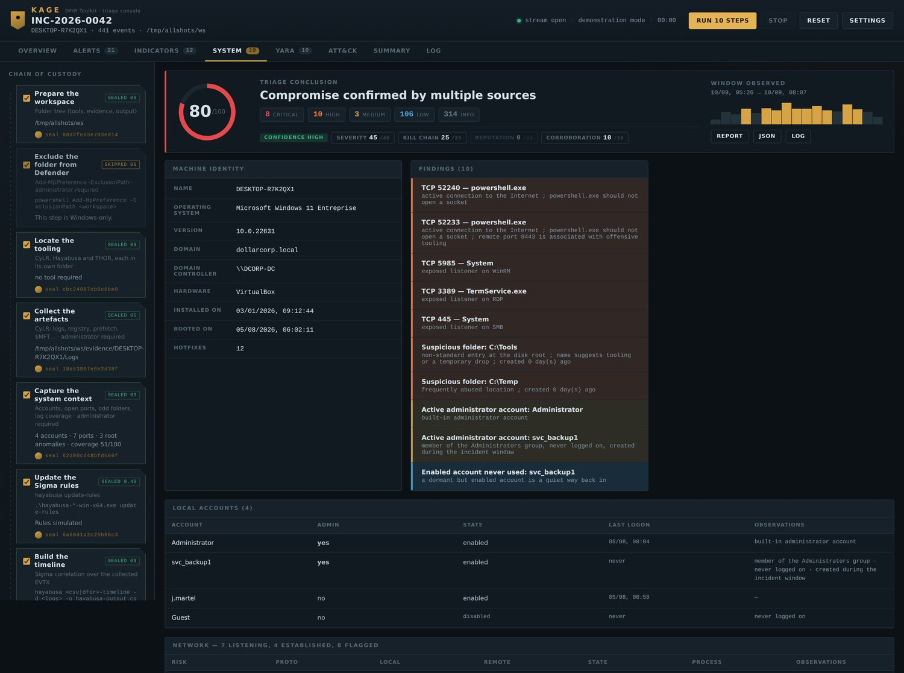

What no event log tells you, captured read-only:

```
NETWORK — 7 listening, 4 established, 8 flagged

RISK    PROTO  LOCAL              REMOTE                PROCESS
HIGH    TCP    10.20.4.11:52233   45.155.205.233:8443   powershell.exe
        → active connection to the Internet · powershell.exe should not
          open a socket · remote port 8443 associated with offensive tooling
HIGH    TCP    0.0.0.0:3389       —                     TermService.exe
        → exposed listener on RDP

ROOT C:\ — 3 flagged entries

HIGH    C:\Tools    folder   created 0 day(s) ago
        → non-standard entry at the disk root · name suggests tooling
HIGH    C:\Temp     folder   → frequently abused location
```

Every socket is matched to its owning process by **PID** — that cross-reference
is what makes `powershell.exe` holding a connection to a public host readable at
a glance.

Local accounts are checked for Administrators membership, dormant-but-enabled
state and last logon. Public addresses from **established** connections join the
indicator list automatically: an address being talked to during triage is worth
at least as much as one read from a three-day-old log entry.

---

## 📋 Logging & audit

A triage is only worth what the machine agreed to record.

```
LOGGING & AUDIT — coverage 51/100 · partial coverage

Blind spots: Sysmon · PowerShell (script blocks) · Process creation
             · Credential validation

STATE     CHANNEL                       IMPORTANCE   EVENTS
ACTIVE    Security                      critical     84 213
MISSING   Sysmon                        critical     —
EMPTY     PowerShell (script blocks)    critical     —
ACTIVE    System                        important    12 045
DISABLED  WinRM                         important    —
```

Sixteen channels classified **active / empty / disabled / missing** — the
distinction matters: an empty channel is one command away from fixed, a missing
one needs a deployment. Thirteen `auditpol` subcategories read alongside.

The coverage score sits next to the risk score. *Risk 80, coverage 51* means the
verdict rests on half the available information — and the report says so.

---

## 🔬 YARA

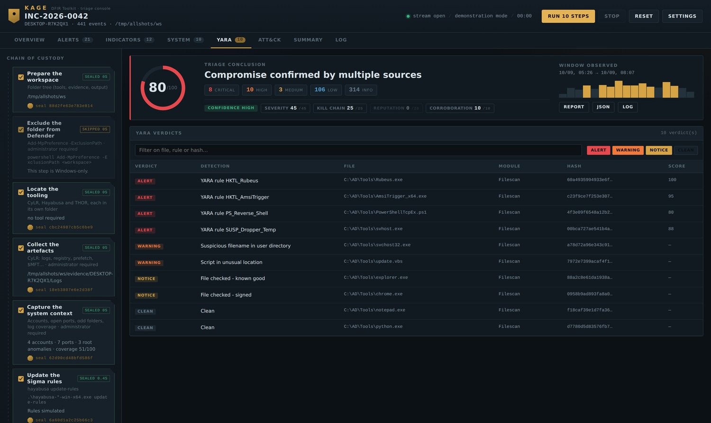

```
8 verdicts

VERDICT   DETECTION                   FILE                         HASH        SCORE
ALERT     YARA rule HKTL_Rubeus       C:\AD\Tools\Rubeus.exe       9c4133ee…   100
ALERT     YARA rule HKTL_AmsiTrigger  C:\AD\Tools\AmsiTrigger.exe  af7af55c…    95
ALERT     YARA rule PS_Reverse_Shell  C:\AD\Tools\PowerShellTcp…   ab1e98e8…    80
WARNING   Suspicious filename         C:\AD\Tools\svchost32.exe    6b6f1901…    —
NOTICE    File checked - signed       C:\AD\Tools\chrome.exe       c5a10bff…    —
CLEAN     Clean                       C:\AD\Tools\notepad.exe      20eded6a…    —
```

The page fills up **during** the scan, not only when something is found. That is
what separates *found nothing* from *looked at nothing*.

**The scan starts at the first real finding.** THOR opens every run with a dozen
banner lines — version, build, hostname, working directory, argument list,
uptime — and closes with a summary. None of it describes the host being
examined, so none of it reaches the view. Hashes from alerts are pushed into the
indicator list, ready for VirusTotal.

---

## 🔐 Seals

Each completed step is sealed with a SHA-256, and the seal **states what it
covers**:

```
✔ Analyse the timeline              SEALED 0.1s
  seal 31d1991a65598de8 — content of hayabusa-output.csv

✔ Exclude the folder from Defender  SEALED 6.2s
  seal 8f2c04b71ae93d55 — execution record (no file produced)
```

When a step produced files, the seal is the hash **of their contents** — rerun
it later and you have proof the artefact was not altered. When it produced none,
the seal covers only the execution record, and says so rather than implying
more.

---

## 🧭 Views

Every view has its own URL, reloads nothing and loses nothing — the analysis
lives server-side and a full refresh restores it.

| Address | Content |
|---|---|
| `/` | pipeline, execution log, breakdown by family |
| `/alerts` | alerts by severity and family |
| `/indicators` | indicators with VirusTotal / AbuseIPDB reputation |
| `/system` | machine, accounts, network, disk root, coverage |
| `/yara` | THOR verdicts, live during the scan |
| `/attack` | inferred ATT&CK tactics |
| `/summary` | written report |
| `/log` | full log, downloadable |

### Live execution

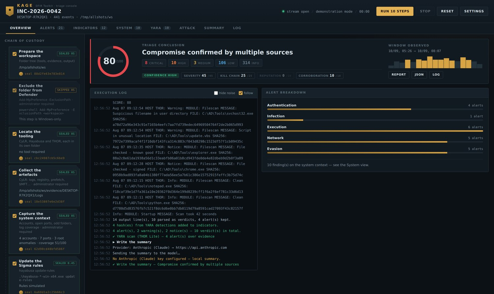

Every command streams as it runs. Steps seal one by one; the clock stops when
the chain does.

### Indicators

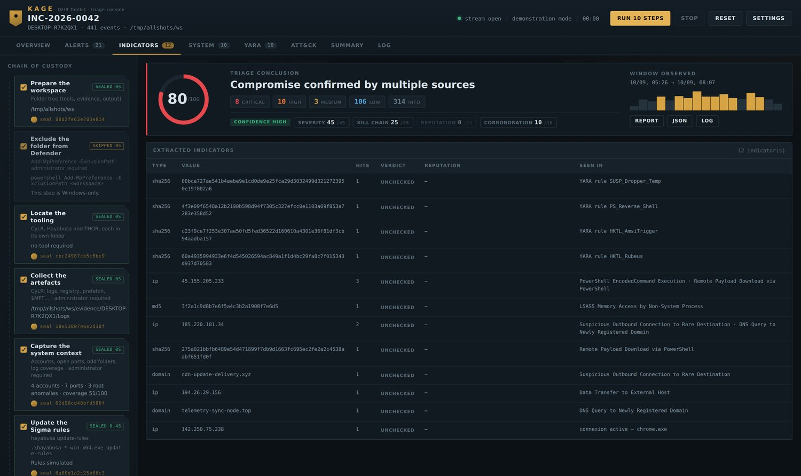

Hashes, IPs and domains pulled from the timeline, from active sockets, and from
YARA hits — each with its reputation once enrichment has run.

### ATT&CK tactics

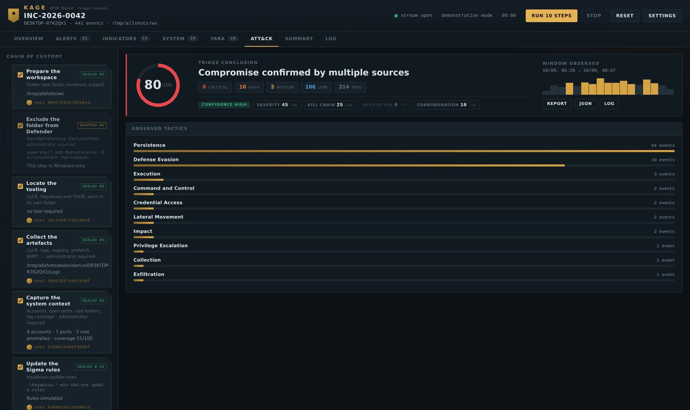

### Reading pane

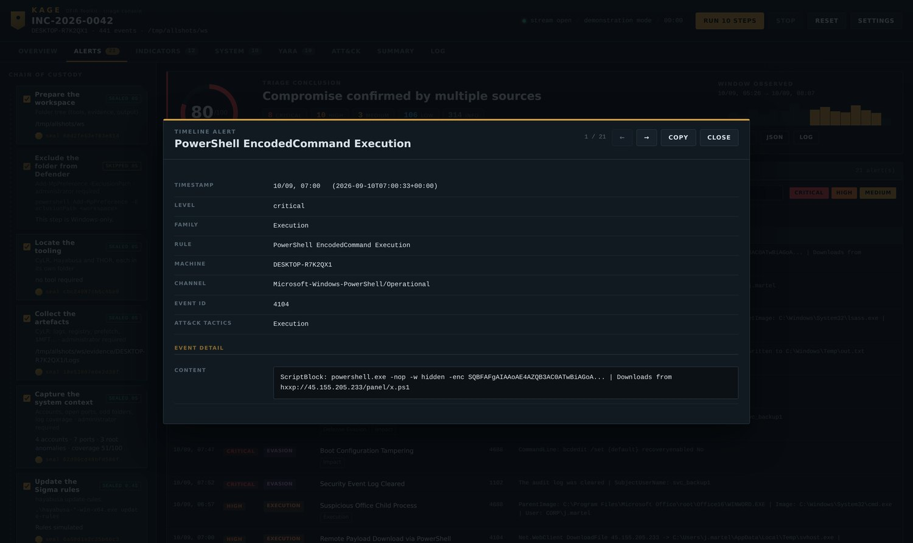

Any row, anywhere, opens in full: every field, the complete command line, the
raw THOR data. `←` `→` to move between items, `Esc` to close, **Copy** for JSON.

### Written summary

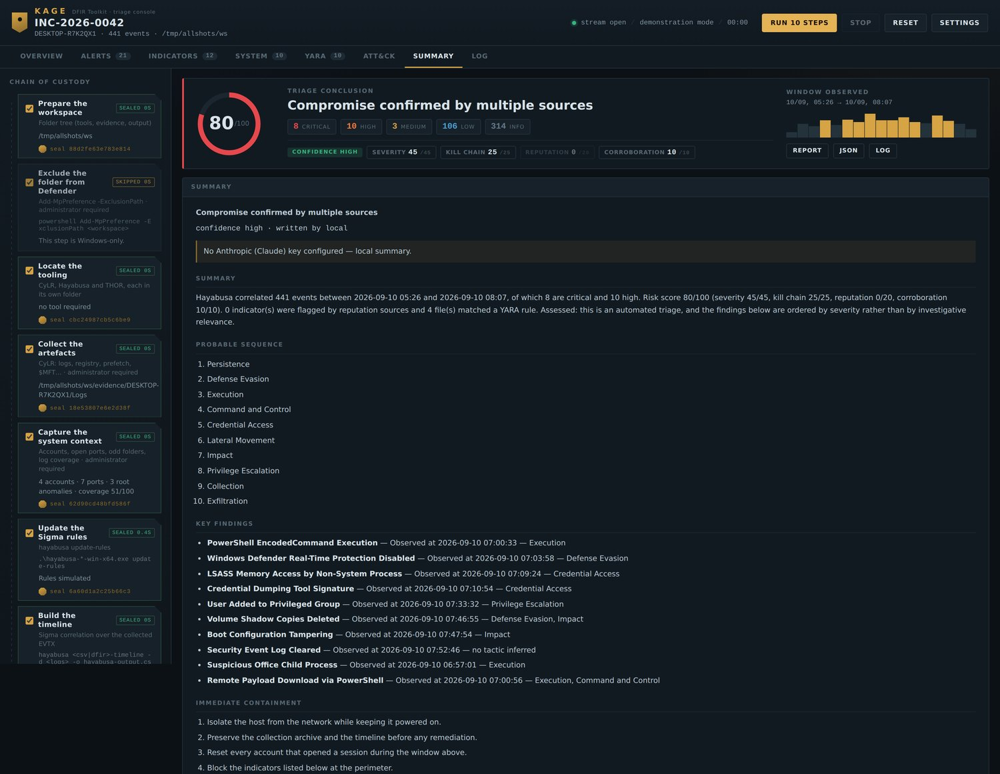

Observed facts separated from assessed ones, calibrated language, and an
explicit evidence-gaps section naming what the logging could not have shown.

### Settings

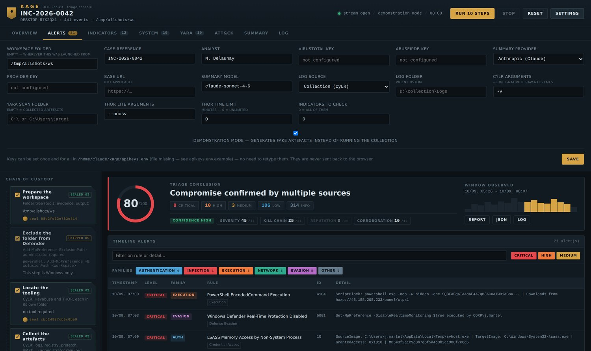

### Execution log

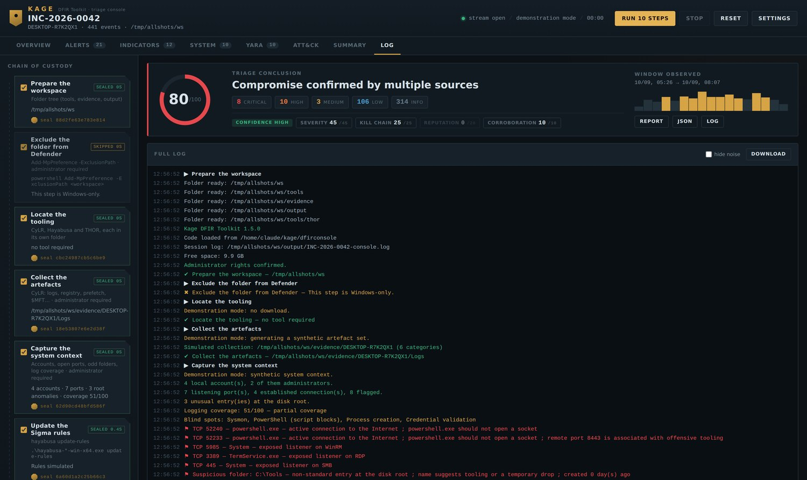

---

## 📄 The report

`/api/report.html` — self-contained, dark, thirteen numbered sections, ready to
print to PDF. No external resource: it stays readable in ten years on an offline
machine.

### Verdict and score

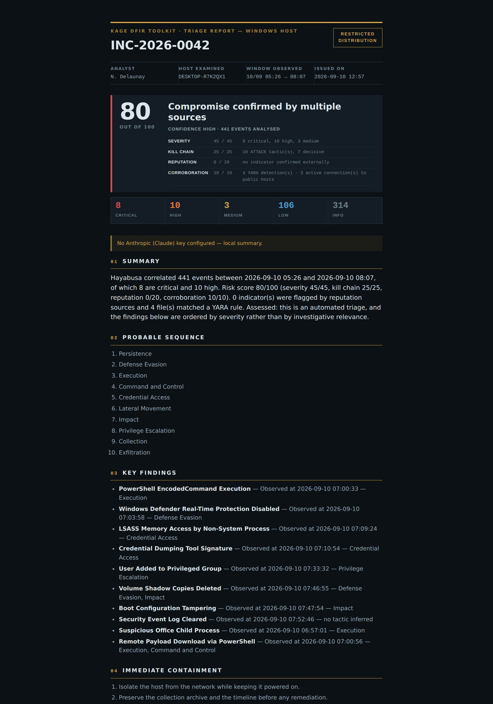

The score never appears without its four components, so a reader can challenge
one axis rather than an opaque number.

### Findings and containment

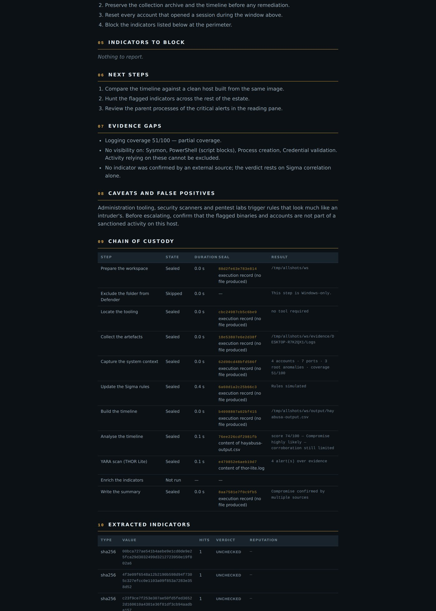

### Evidence gaps and chain of custody

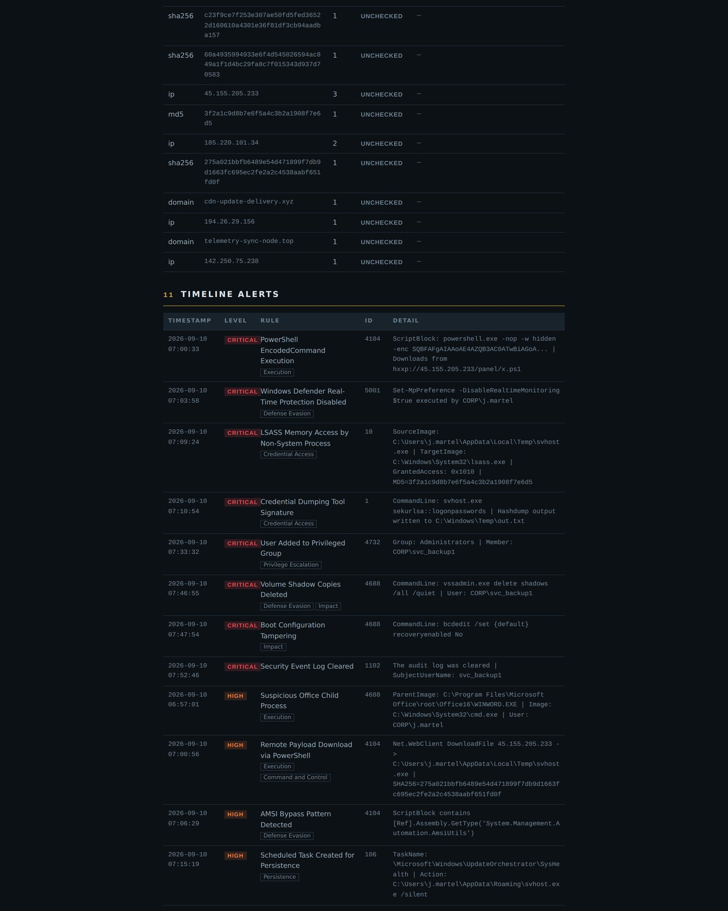

Every step with its seal and **what that seal covers** — the content of a named
file, or the execution record alone.

> When printing to PDF, tick *Background graphics* in the browser options,
> otherwise the dark background is dropped.

---

## ⚙️ Configuration

### Tooling layout

Each tool owns a folder, and each ships with a README explaining what goes in it.

```
<workspace>/
├── tools/
│   ├── cylr/        CyLR.exe                 ← downloaded automatically
│   ├── hayabusa/    hayabusa-<version>.exe   ← downloaded automatically
│   └── thor/        thor64-lite.exe + .lic   ← manual, registration required
├── evidence/        collection archive, unpacked
└── output/          timeline, logs, enrichment cache
```

**CyLR and Hayabusa install themselves.** The *Locate the tooling* step queries
the GitHub releases API, picks the current Windows x64 asset and unpacks it into
the right folder. Pinning a version means the download breaks the day upstream
moves on; resolving it means the console keeps working unattended. A pinned URL
takes over if the API is unreachable.

### API keys — all optional

Everything works without a single key. Unconfigured steps are marked *skipped*,
never *failed*.

**Where credentials go.** The repository ships `apikeys.env.example`, a template
with empty values. Copy it, keep the copy local:

```powershell
copy apikeys.env.example apikeys.env
notepad apikeys.env
```

```ini
# apikeys.env — sits next to kage.exe (or launch.bat)
VT_API_KEY=your_virustotal_key
ABUSEIPDB_API_KEY=your_abuseipdb_key

AI_PROVIDER=groq
AI_API_KEY=your_provider_key
AI_MODEL=
```

**Where to get them**

| Key | Free tier | Sign up |
|---|---|---|
| `VT_API_KEY` | 4 requests/minute, 500/day | [virustotal.com](https://www.virustotal.com/gui/join-us) |
| `ABUSEIPDB_API_KEY` | 1 000 checks/day | [abuseipdb.com](https://www.abuseipdb.com/register) |
| `AI_API_KEY` | varies — Groq and Ollama are free | see the provider table below |

You can also set them as environment variables instead of a file, which is
usually what you want in a container or on a shared responder workstation:

```powershell
$env:VT_API_KEY = "..."
python -m dfirconsole
```

### Summary providers

Each has its own endpoint, wired explicitly, so choosing Groq never sends your
key to OpenAI.

| Provider | Endpoint | Default model |
|---|---|---|
| Anthropic | `api.anthropic.com` | `claude-sonnet-4-6` |
| OpenAI | `api.openai.com/v1` | `gpt-4o` |
| Groq | `api.groq.com/openai/v1` | `llama-3.3-70b-versatile` |
| Mistral | `api.mistral.ai/v1` | `mistral-large-latest` |
| OpenRouter | `openrouter.ai/api/v1` | `anthropic/claude-sonnet-4` |
| Ollama | `localhost:11434/v1` | `llama3.1` — no key |
| None | — | local write-up |

Small free tiers are handled: Groq allows 12 000 tokens per minute, so the
payload is measured against that ceiling and, on a size rejection, replayed with
fewer alerts and shorter details. The verdict survives; only the supporting
evidence thins out.

The model is held to a standard — observed separated from assessed, calibrated
language, quantified statements, explicit evidence gaps, and the benign
explanation considered.

---

## 📟 CLI reference

`kage.exe` and `python -m dfirconsole` take the same options.

```
kage.exe                               console on 127.0.0.1:8787, browser opens
kage.exe --port 9000                   custom port
kage.exe --demo                        synthetic data, no collection
kage.exe --image D:\case\PC07.E01      start on a disk image
kage.exe --remote PC07                 start on a remote host (WinRM)
kage.exe --remote PC07 --remote-user .\Administrator   password asked once
kage.exe --no-browser                  do not open the browser
kage.exe --check                       environment check, writes nothing
kage.exe --version                     print the version

python preflight.py D:\CASE42          check another workspace

python -m pytest tests/ -q             158 tests, disk images and remote hosts included
python tests/ui_check.py               browser: full chain, reading pane
python tests/ui_nav.py                 browser: navigation, counts, histogram
python tests/ui_flood.py               browser: 6000 log lines at once
python tests/ui_buttons.py             browser: every button, filter and export
python tests/e2e_sources.py --hayabusa <dir> --logs <evtx dir> [--images <dir>]
                                       every source, real Hayabusa, same results
python tests/score_eval.py <hayabusa verbose csv>
                                       score calibration on ~1 000 real cases
```

All times shown in the console, the report and the exports are **UTC**, with
the year, so a timeline lines up with other tools whatever the analyst's clock.

Browser runs need `pip install playwright && playwright install chromium`.

---

## 🔧 Troubleshooting

**"Administrator rights required" / Defender exclusion refused**
Kage is not elevated. Close it, right-click `launch.bat` → *Run as
administrator*, or open PowerShell as administrator first.

**`did not find executable … python.exe`**
Your Python came from the Microsoft Store, which installs per user and vanishes
in an administrator session. Reinstall from python.org, *for all users*.

**CyLR produced no archive / the collection is empty**
Add `--force-native` to **Settings → CyLR arguments**. It drops raw NTFS reading
for the Windows API, which works when partition detection fails on a disk.

**THOR starts then goes silent**
Its licence is missing or expired, or `signatures\` was not copied next to the
binary. Run `kage.exe --check` to confirm.

**"Image not found" / "no Windows volume found in the image"**
Check the path points to the first segment (`.E01`, not `.E02`) and that all
segments sit in the same folder. A BitLocker volume must be decrypted first.

**Remote host: "no WinRM answer"**
On the target, as administrator: `Enable-PSRemoting -Force`, then allow TCP 5985
from your workstation. `Test-WSMan <host>` from your workstation must answer.

**Remote host: "connected but without administrator rights"**
The account is not in the host's Administrators group, or it is a local
account stripped by UAC. Use a domain admin account, or set
`LocalAccountTokenFilterPolicy` to 1 on the target.

**The exe is blocked or deleted by the antivirus**
One-file executables unpack themselves at start, which some engines dislike.
Compare the hash with `SHA256SUMS.txt` from the release, then allow it, or run
from source.

---

## 🏗️ Builds and releases

Two GitHub Actions workflows live in `.github/workflows/`:

| Workflow | When | What it does |
|---|---|---|
| `ci.yml` | every push and pull request | unit tests on Windows and Linux, then the four browser runs |
| `build.yml` | every `v*` tag, or by hand from the Actions tab | builds `kage-windows-x64.exe` and `kage-linux-x64` with PyInstaller, smoke-tests each one from an empty folder (demo chain and an E01 triage), publishes them as build artifacts |

Pushing a tag publishes a release with both files and `SHA256SUMS.txt`:

```bash
git tag v1.6.0
git push origin v1.6.0
```

To build locally:

```bash
pip install -r requirements.txt -r requirements-dev.txt
pyinstaller kage.spec                       # → dist/kage.exe or dist/kage
python build_support/smoke_test.py dist/kage.exe
```

---

## 🐧 Linux version

**Today:** the Linux build (`kage-linux-x64`) runs the console and does full
**dead-disk triage** of Windows images, with the Linux build of Hayabusa.

**In progress:** triage of Linux hosts themselves, on the same console, views
and scoring model. What changes is the evidence layer:

| Windows | Linux (in progress) |
|---|---|
| CyLR collection | UAC / CyLR Linux collection |
| EVTX + Hayabusa Sigma | `journald` / `auth.log` / `syslog` + Sigma |
| `Get-LocalUser` · `auditpol` | `/etc/passwd` · `/etc/shadow` · `auditd` rules |
| `netstat -ano` + `tasklist` | `ss -tunap` |
| Disk root anomalies | `/tmp` · `/dev/shm` · `/var/tmp` · cron · systemd units |
| THOR Lite | THOR Lite for Linux |

Star or watch the repo to catch the release.

---

## 🙏 Credits

Kage is a console, not a collector or a scanner. The heavy lifting belongs to
these projects, and they deserve the star far more than this repo does:

| Tool | Repository | Role in the chain |
|---|---|---|
| **CyLR** | [orlikoski/CyLR](https://github.com/orlikoski/CyLR) | live artefact collection over raw NTFS |
| **Hayabusa** | [Yamato-Security/hayabusa](https://github.com/Yamato-Security/hayabusa) | Sigma correlation, timeline generation |
| **Sigma** | [SigmaHQ/sigma](https://github.com/SigmaHQ/sigma) | the detection rules behind every alert |
| **THOR Lite** | [NextronSystems/thor-lite](https://github.com/NextronSystems/thor-lite) | YARA and IOC scanning |
| **VirusTotal** | [virustotal.com](https://www.virustotal.com) | hash, IP and domain reputation |
| **AbuseIPDB** | [abuseipdb.com](https://www.abuseipdb.com) | IP abuse scoring |
| **MITRE ATT&CK** | [attack.mitre.org](https://attack.mitre.org) | the tactic framework behind the kill-chain axis |

Respect each project's own licence and terms of use — THOR Lite in particular
requires registration with Nextron and is not redistributable.

---

## 🌐 Ecosystem

| | Tool | Domain |
|---|---|---|
| ☁️ | [**Kumo** 蜘蛛](https://github.com/karim852/KUMO-Domain-Recon-Tool) | domain OSINT & reconnaissance |
| 🌑 | **Kage** 影 | DFIR host triage |

---

> ⚠️ **For authorized incident response only.**
> Only run Kage on hosts you own or have explicit written permission to examine.
<p align="center"><sub>Built for those who arrive after. 影</sub></p>
